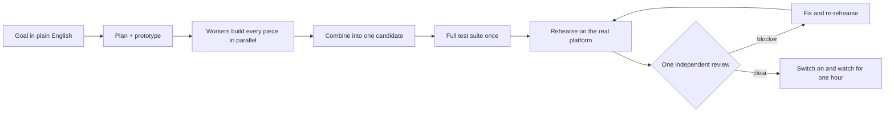

# BGZFLOW

**Run a team of AI coding agents like a real product team, from a plain-English idea to a working launch.**

BGZFLOW is a free, open-source plugin for Claude Code, Codex and Grok. One lead agent plans the work, a swarm of workers builds every piece in parallel, and the whole product is then tested once on the real platform before it goes live. It runs on the agents and subscriptions you already have.

**New here? Start with the [getting started guide](docs/getting-started.md): your first ten minutes.**

**Created by [Simeon Kontogeorges](https://github.com/socialiserapp-design)**

[](LICENSE)
[](CHANGELOG.md)


---

## New in 0.9.2: BGZFLOW Next (Outcome Contracts, Ground-Truth Research, Jev Goal Clarity & Rebuild Mode)

BGZFLOW 0.9.2 upgrades the workflow around five universal pillars while keeping every existing self-improvement (`bgz lessons`, `bgz jev grade/league/outcomes/improve`, `bgz facts`) and communication (`bg-plain-english-builder`, `bg-mail`, `bgz map`) tool intact:
- **Outcome Contracts & Vertical-Slice Real-Surface Testing (`record slice`)**: done means **USED** on the real surface, never just a commit or PR, and never a "Stage A shell / Stage B wiring" split.
- **Pre-Decision Ground-Truth Research (`record ground-truth`)**: verify external APIs (like Zernio), statutes, papers or schemas before locking decisions.
- **Open-World Jev Goal Interrogation (`bgz jev score --preset goal-clarity`)**: dynamically discover any user domain and interrogate only until `goal-clarity >= 0.88` (`ready_to_execute: true`), with opt-in milestone check-ins for long-horizon tasks.
- **3-Model Council (`ROLE: architect | executor | verifier`)**: upfront 3-model spec/contract alignment, single vertical-slice executor, and cross-model adversarial verification.
- **Rebuild vs. Evolve Triage (`TRIAGE: rebuild | evolve | keep-shared-brain`)**: first-class clean rebuild mode with explicit `retiredGuards` for superseded source-shape tests and automatic `rebuildRecommended` escalation after 2 failures on a legacy patch.

## New in 0.9.0: one system map, kept by one owner

BGZFLOW 0.9.0 adds a system map. `bgz map` shows your repos, worktrees, services and deployments, and every change in flight with the stage it has reached: planned, committed, integrated, deployed or production-verified. Git proves committed and integrated. The owner records deployed and production-verified with evidence. Workers end each handback with a `Changed:` line per change, and the owner keeps the map and passes it on through the inbox, the checkpoint and the handoff. It is advice only: it blocks nothing and asks no one anything. See [the system map](docs/system-map.md).

## New in 0.8.0: start faster

BGZFLOW 0.8.0 helps a project start faster, with a start-now list of ready tasks, a plan check for extras nobody asked for, automatic project setup, project facts and a getting-started guide.

## New in 0.7.0: build the way professional teams do

An architecture audit of a live app found the same twelve causes behind most of its failures. BGZFLOW 0.7.0 builds the fixes into the skills, so every project gets them by default, with no new gates or reviews:

- **Know what is live**: a release records exactly what it ships and compares it with what is actually serving, so rollback targets are known.
- **One owner per system**: work is split by system, not by app, server and database, and systems meet only at a written, versioned contract.
- **Tests that prove outcomes**: contract tests from the consumer's side, the oldest installed app checked before deploy, customer outcomes asserted in provider test mode, and the test environment proved before any result is trusted.
- **Watch customers, not machinery**: monitor due work, newest customer output and money balance, plus a company canary; a green job is not health.
- **Learn from repeats**: numbered decision records, a 0-4 architecture scorecard, durable multi-step paid work, rebuild-beside-the-old, and `bgz lessons rework` to count repeat fixes of the same cause.

## New in 0.6.0: Jev, a fast and cheap judge for every agent

Big models are slow and expensive for small calls like "is this command risky?", "which worker should take this job?" or "did that test fail for real?". BGZFLOW 0.6.0 adds **Jev**: a judgement layer that answers many small questions about the real situation in about a second, for a fraction of a cent, with a confidence score. Weights and thresholds stay in code, and any Jev error fails open, so it never blocks work.

- **Guards**: risky shell commands, credential leaks in edits and injected instructions in tool output are caught before they do harm.
- **Routing and grading**: Jev picks the right worker and skills for each job, grades every finished job on a rubric and keeps a league table, so the best workers and workflows rise.
- **Self-improving**: a workflow that consistently beats the average becomes a skill, with a backup, a watch period and automatic restore.
- **Smarter chats**: it decides when a long chat should hand off, and answers questions about files without opening them.

See the [changelog](CHANGELOG.md) for the full list.

## Why BGZFLOW

AI agents are fast at writing code and bad at finishing products. Left alone they review each other in circles, test pieces that never get assembled, lose track after a restart, and quietly leave finished work switched off. BGZFLOW is a small set of working rules, skills and local guard tools that fix those failure modes:

- **Build the whole thing, then test the whole thing.** Workers build every piece in parallel with fast checks only, and build only what was asked. Nothing is reviewed or released piece by piece.
- **Prove it on the real platform.** The finished candidate runs its key customer journeys and one rollback on a real preview, staging slot, TestFlight or internal track, with real accounts and money in test mode.
- **One review, five reasons to stop.** A single independent read-only review per release can block only on wrong money, data loss, security or privacy, a missing rollback, or a customer-facing stop path (a wait, refusal, hold, gate, cap, block or expiry) the founder never approved in writing, each with a reproduction. The review lists every new stop path with the founder's quoted approval. Everything else goes on the after-launch list. Repairs are proven by re-running the rehearsal, never by another review.
- **Finished means switched on.** Accepted work goes live for its customers the moment it passes, with an hour of live error-watching. Finished work left off is flagged within a day.
- **You decide once.** You approve the resources and usage limit for a swarm up front. After that the lead runs the work and asks only about genuine product, money or release decisions.
- **Pick up where you left off.** One-page checkpoints and a recovery skill let any agent, on any host, continue a project after a crash, a restart or an account switch.

## How it works



The lead agent recovers the project's current state, proposes a short plan and asks once which workers and usage it may spend. From there it carries the approved work through building, integration, whole testing, the release and recovery. Publishing, store submission and payments still need your explicit authority.

## Install

Requirements: your agent's CLI and Node.js 18 or newer. Python 3.10 or newer is needed only for the optional notes map. BGZFLOW installs no npm packages.

**Claude Code**

```shell
claude plugin marketplace add socialiserapp-design/BGZFLOW
claude plugin install bgzflow@bgzflow
```

**Codex**

```shell
codex plugin marketplace add socialiserapp-design/BGZFLOW
codex plugin add bgzflow@bgzflow
```

**Grok**

```shell
grok plugin marketplace add socialiserapp-design/BGZFLOW
grok plugin install socialiserapp-design/BGZFLOW
```

The [install guide](docs/install.md) covers updating, uninstalling and the optional private settings folder.

## Quick start

Open an existing repository in your agent and describe the result you want:

```text
/bgzflow:swarm Add Apple and Google sign-in, and make sure existing email users keep their accounts
```

Claude Code and Grok load the commands directly. Codex does not load plugin slash commands yet, so ask it:

```text
Read the installed BGZFLOW commands/swarm.md and run that workflow for this goal: <your goal>
```

## Commands

| Command | What it does |
|---|---|
| `/swarm <goal>` | Plan, build every piece in parallel, combine, test the whole and check it independently |
| `/swarm-fix <findings>` | Fix a batch in parallel, re-combine and retest the whole journey (two rounds at most) |
| `/swarm-research <question>` | Investigate several angles in parallel and return one sourced answer |
| `/swarm-design <target>` | Explore at least eight genuinely different designs, then prototype your choice |
| `/swarm-check [candidate]` | Rehearse the complete candidate on the real platform, then run the one review |
| `/swarm-ship <version>` | Prepare a release, switch it on within your authority and watch it live |
| `/swarm-status` | Show running, stale and finished jobs, with duplicates and mismatches flagged |
| `/swarm-resources` | See which agents and accounts are available, and approve what a swarm may use |

Supporting tools: `/bg-heavy` queues heavy local builds one at a time, `/bg-swarm` launches and stops local workers, `/bg-rounds` keeps the repair-round ledger, `/swarm-gate` enforces the swarm's limits and release order, `/doctor` checks for leaked secrets and context costs, `/notes-map` finds the right lines in long project notes, and `/startup-check` keeps start-up reading short.

`bgz map` shows the system map: your repos, services and deployments, and how far each change has got ([details](docs/system-map.md)).

## Lessons to rules

Each finish report records what went wrong in the project's private, append-only lessons log. Repeated patterns, or one high-severity lesson, become due for review. The lead prefers a test, hook or required report field; know-how becomes a skill edit. Promotions follow the normal build, test, independent check and release path. SessionStart and the startup check show one line only when reviews are due.

Reports distinguish **BUILT**, **REACHED** and **USED**; only a real journey with current data can be called working. Each next step says how to confirm it. Run `node <plugin>/tools/bgz.mjs lessons --help` for the local CLI and see the [lessons guide](tools/lessons/README.md).

## What's inside

**Nine skills**, each loaded only when its stage applies:

| Skill | Use it for |
|---|---|
| Plain English Builder | Turning an everyday idea into research, a clickable prototype and a buildable plan |
| Build With Me | Managing a substantial goal end to end, choosing the right stages and workers |
| Personal Product Design | New looks, screens and flows: eight or more directions from a library of distinct looks, cinematic motion and 3D where it fits, and device checks |
| Finish the Whole Job | Turning an agreed plan into one integrated, working product |
| Check It Before Release | Real-platform rehearsal and the single release review |
| Ship and Recover | Switching accepted work on, the first live hour, rollback and incidents |
| Continue My Project | Resuming after a crash, a break or a host or account change without losing work |
| Efficiency | Saving tokens and usage without cutting scope or quality |
| Jev | Quick scored checks before dispatching, reading files or judging work: test failures, diff risk, plans and unasked changes |

**Local guard tools and hooks**: the swarm gate (resources, usage limits, ownership, retry and release order), resource and status views, a heavy-job queue, a resource governor that protects disk and build slots, a worker mailbox, account-route receipts and a real-clock hook. See [swarm gate](docs/swarm-gate.md), [testing ladder](docs/testing-ladder.md), [mailbox](docs/mailbox.md), [resource governor](docs/resource-governor.md) and [account routing](docs/account-routing.md).

## Safety and privacy

- Hooks are small Node.js programs that run on your machine, with no dependencies. Read [SECURITY.md](SECURITY.md) and review `hooks/hooks.json` before you install or update.
- Jev guardrail switches: `BGZFLOW_JEV_GATES=off` turns all Jev gates off; `BGZFLOW_JEV_SCREEN=off`, `BGZFLOW_JEV_BASH=off` and `BGZFLOW_JEV_WRITE=off` turn off one each; `BGZFLOW_JEV_BREAKER=off` ignores the 5-minute outage pause. `BGZFLOW_OVERRIDE="<approved step>"` lets one approved step through once and logs it to `<BGZFLOW_HOME>/overrides.jsonl`. `writeAllow` in the overlay config (or `BGZFLOW_WRITE_ALLOW`) adds folders the write gate accepts. `BGZFLOW_DECISIONS_FILE` names the owner's decisions file (default `DECISIONS.md`).
- Your own notes, routes and project list live in a private folder outside this repository (`~/.bgzflow/overlay/` by default) and are never published.
- BGZFLOW never buys capacity, never switches accounts silently and never publishes, submits to a store or moves money without your recorded authority.
- Continuous integration runs the test suite, a manifest drift check, a leak check over files, history and identities, and gitleaks.

## Project status

BGZFLOW is used every day to build and run several real products across Claude Code and Codex. It is young and moving quickly; see the [changelog](CHANGELOG.md) and [verification evidence](docs/proof.md). Issues and pull requests are welcome. Please report security problems through a private security advisory.

## About the author

BGZFLOW is designed and built by **Simeon Kontogeorges**. It grew out of running a whole product company with AI agents: every rule in it comes from a real failure in a real product, turned into a test, a hook or a skill so it never happens twice.

- GitHub: [socialiserapp-design](https://github.com/socialiserapp-design)

If BGZFLOW helps you ship, a star on this repository is the best thanks.

## Licence

MIT. Copyright (c) 2026 Simeon Kontogeorges. Third-party ideas and sources are credited in [ATTRIBUTION.md](ATTRIBUTION.md).
