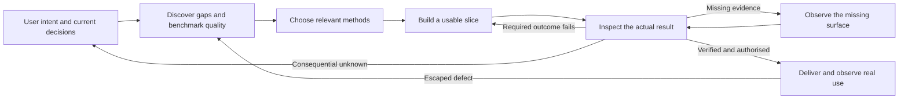
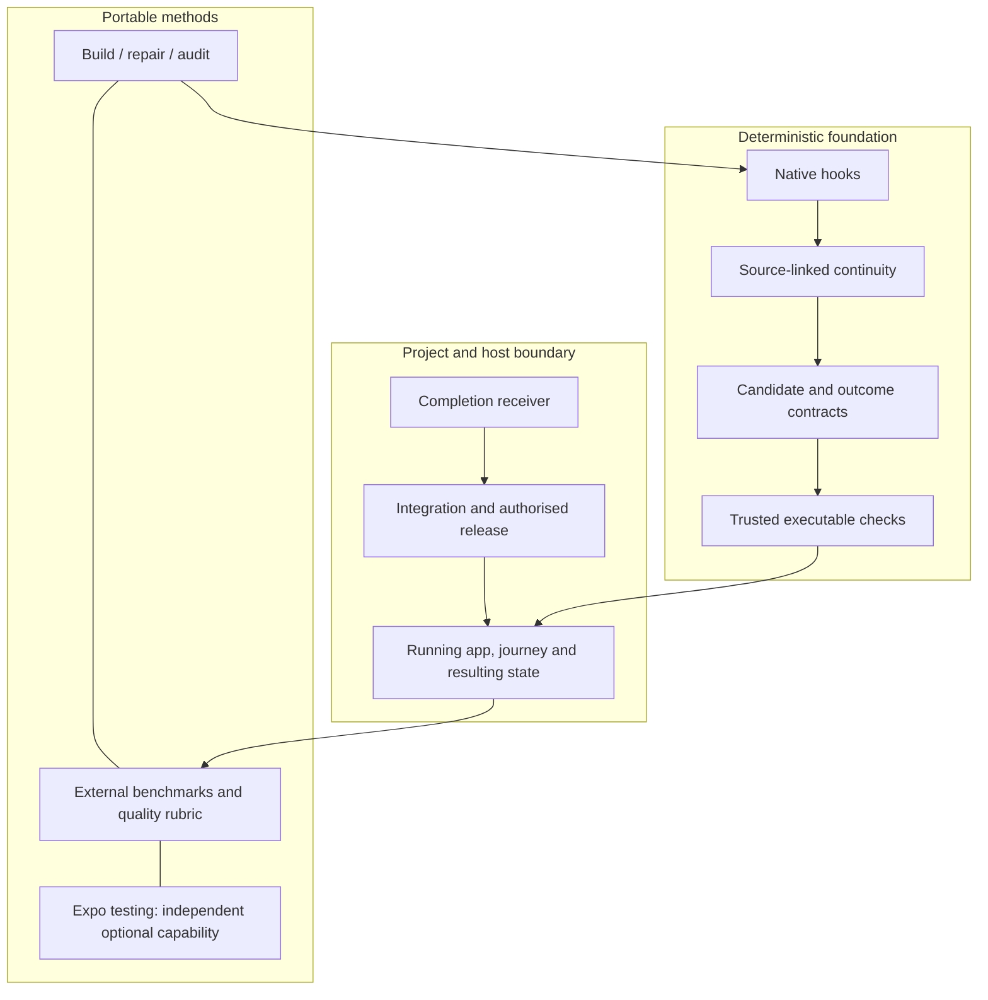

# Architecture: from intent to observed outcome

BGZFLOW is a portable workflow foundation, not a replacement IDE or a claim that
an AI can guarantee correctness. Product architecture and integration direction:
[Simeon Kontogeorges](../AUTHORS.md). Implementation and evaluation were developed
with AI assistance; upstream authors retain their attribution.

## The operating loop

The lead stays accountable for worker results, integration, authorised delivery
and checks of the running artifact. A completed worker or a green build is an
input to that loop. A skill cannot wake an idle lead: the native host's completion
receiver or another supported integration must do that.

## Three different responsibilities

| Layer | Responsibility | What it cannot prove |
|---|---|---|
| Methods and model judgment | Clarify consequential choices; discover omitted needs; research references; critique product, content and code | Truth, permission or a real external effect by assertion |
| Deterministic runtime | Preserve events and provenance; deliver relevant context; correlate revisions/operations; validate configured checks and quality reports | Whether a weak evaluator truly measures quality |
| Host and project integration | Permissions, native workers, actual capacity, CI, release tools, device/browser/service observers and recovery | Universal autonomy merely because the plugin is installed |

## Quality beyond “it runs”

The [full-spectrum audit](../skills/bg-full-spectrum-audit/SKILL.md) challenges the
underlying product as well as its implementation. The
[quality method](../skills/bg-outcome-evals/references/product-quality.md) compares
real results with a task-specific standard. Its
[benchmark discovery](../skills/bg-outcome-evals/references/quality-benchmarks.md)
finds current professional guidance, comparable experiences and alternative
architectures without requiring the owner to name every possible omission.

Exact facts belong in deterministic assertions. Meaning and craft may need an
independent, calibrated evaluator with the actual evidence. Jev is an optional
provider, not a universal judge or a prerequisite. Paid calls require the user's
authority and protected credentials. AI-versus-deterministic allocation remains
an explicit audit topic.

Configured executable checks can require evidence for each required criterion,
bound to the candidate and rubric. Missing or stale evidence cannot pass; an
average score cannot erase an essential failure. This protects a configured
acceptance path, not arbitrary tool calls made outside it. See
[the integration contract](foundation-session.md) and
[enforcement boundaries](enforcement-boundaries.md).

## Evidence and portability

The source suite exercises continuity, interrupted work, host adapters, package
construction, quality failure cases and actual local process/file observations.
These are software and mechanism checks, not evidence that every downstream app
has been installed and used successfully. Each host/project needs its own short
real completion-to-app rehearsal. Preserve that distinction in release claims.

Private account state, project histories, decision filenames and team lessons stay
outside the distributable package. Use the generic decision default or an explicit
local preference. Follow [installation](install.md) and load only the relevant
methods from the 103-skill library.
